# 1st Nesting user guide

## 1. Add your parts

Open your FreeCAD model or STEP file, select **1st Nesting** in the workbench selector, and click **Nesting Tool**. The examples below use four parts: **Front A**, **Front B**, **Curved shelf**, and **Small insert**. The two fronts have through holes; the shelf has a curved edge.

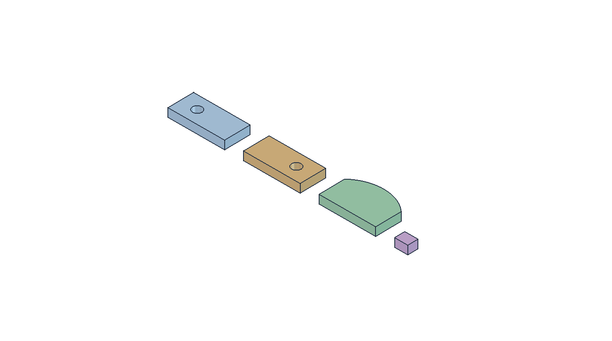

### Add Selected: FreeCAD and STEP parts

1. Open the source model with FreeCAD's **File → Open**.
2. Select the bodies or solid objects in the model tree or 3D view. Use **Ctrl** to select several objects.
3. Click **Add Selected** at the bottom of the nesting panel. If you selected objects before opening **Nesting Tool**, they can be added automatically when the panel opens.
4. Check that each required part appears in **Selected Parts (Preview Mode)**.

1st Nesting creates working copies in **Nesting_Preview** and aligns them for nesting. Adjustments to these copies leave your source model unchanged. Check which face is facing upward, especially on parts with drilling or grooves on only one side.

### Import DXF… and Import SVG…: 2D parts

Use **Import DXF…** or **Import SVG…** to load part profiles directly. Select the file or files in the file chooser and open them. Imported parts appear in the same table as parts added from a 3D model.

Use closed, correctly scaled outlines. After importing, inspect the preview, quantities, and inner contours. For a DXF that should become available stock rather than a part, use the material **Add** button described in [section 3](#3-add-sheets-and-offcuts).

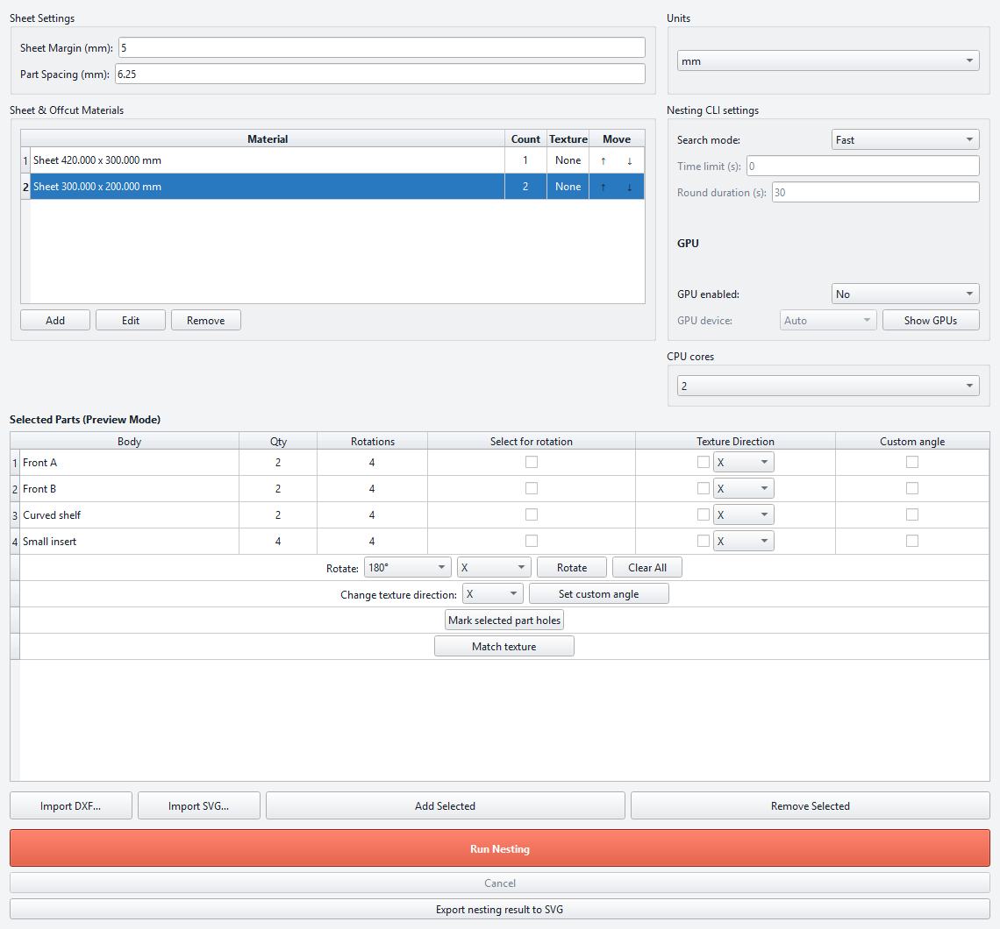

*The panel is shown at a wide size for readability. FreeCAD may place it in the Tasks dock; the controls have the same names.*

## 2. Check the part list and preview

| Table field | How to use it |
| --- | --- |
| Row number | Identifies the row, including a saved texture group. |
| **Body** | Identifies the part. Click the row to select its preview geometry. |
| **Qty** | Double-click and enter the required number of copies. Use a positive whole number. |
| **Rotations** | Double-click and enter the orientations the nesting engine may use. See [section 5](#5-set-allowed-nesting-rotations). |
| **Select for rotation** | Check the parts that the main **Rotate** button should prepare. |
| **Texture Direction** | Enable a texture constraint and choose the part's local **X** or **Y** direction. |
| **Custom angle** | Also enable **Texture Direction**, then use **Set custom angle**. |

Clicking a row and checking **Select for rotation** serve different purposes. Row selection is used by commands such as **Remove Selected**, **Mark selected part holes**, and **Match texture**. The checkbox chooses the targets of the main **Rotate** command.

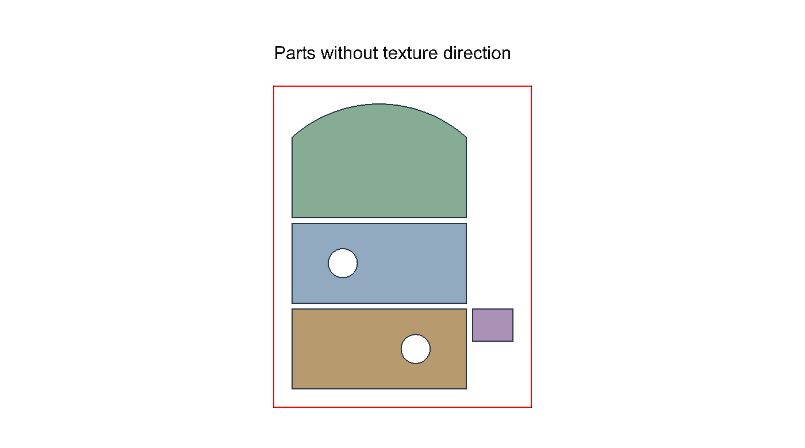

The preview shows the actual geometry being prepared. This is a preparation layout; the final sheet layout appears after **Run Nesting**.

### Remove Selected

Select the unwanted table rows and click **Remove Selected**. The rows and their working preview copies are removed from the nesting job. You can add the source objects again with **Add Selected**.

Removing a texture group row removes the group's member parts from the job too. To keep the parts and only undo their grouping, use **Remove matching** inside **Match texture** instead.

## 3. Add sheets and offcuts

Every nesting job needs at least one material entry. Use **Add** under **Sheet & Offcut Materials**.

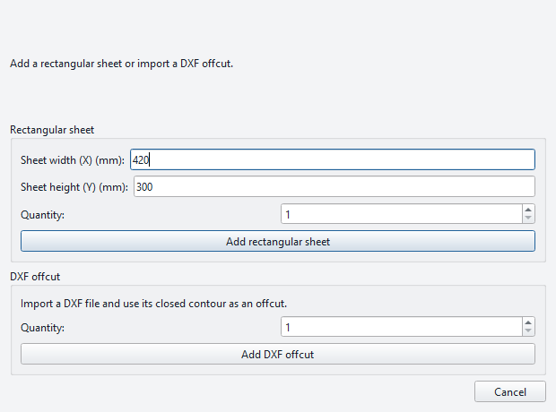

### Rectangular sheets

1. Enter **Sheet width X** and **Sheet height Y** in the displayed units.
2. Set **Quantity** to the number of available sheets of this size.
3. Click **Add rectangular sheet**.

For this example, add one **420 × 300 mm** sheet. Width follows the material's local X axis; height follows its local Y axis. Adding the same rectangular size again increases its **Count**.

### DXF offcuts

1. In the **DXF offcut** section, set **Quantity**.
2. Click **Add DXF offcut** and select the DXF file.
3. Inspect the resulting material contour with **Edit**.

The closed outer contour defines the stock boundary. Inner contours can identify areas that must be excluded, such as existing holes. The dialog's **Cancel** button closes it without adding a material.

### Manage the material list

The material list is visible in the [main-panel illustration](images/user-guide/02-main-window.png).

| Control | Effect |
| --- | --- |
| **Material** | Shows the sheet dimensions or offcut name. |
| **Count** | Double-click to change the number of available copies. |
| **Texture** | Displays the material's texture direction; change it through **Edit**. |
| **Move ↑ / ↓** | Moves a material row up or down in the material list. |
| **Add** | Adds a rectangular sheet or a DXF offcut. |
| **Edit** | Opens previews for the selected material rows. |
| **Remove** | Removes the selected material rows from the available stock. |

The **Move** arrows change list order. They do not move a stock outline around the 3D view.

### Edit material contours and texture

Select one or more material rows, then click **Edit**. Each selected material has its own preview card.

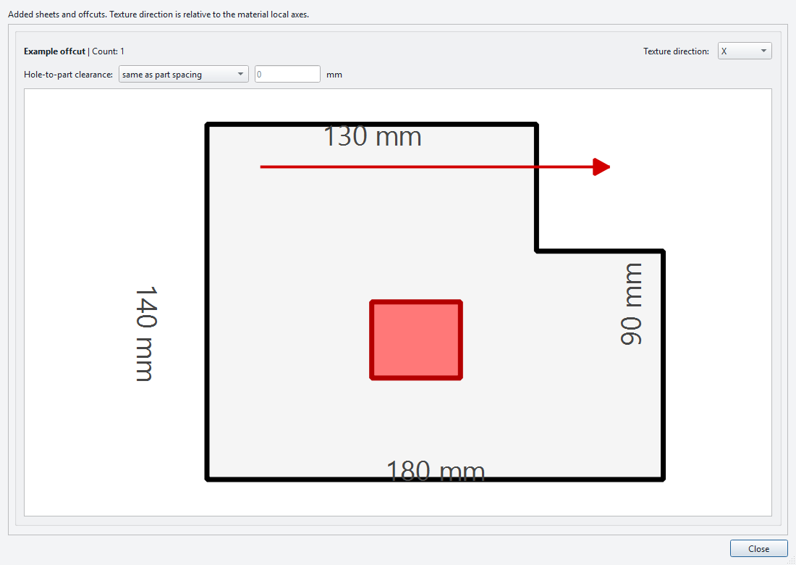

Use the following controls:

- **Texture direction: None / X / Y**: choose the texture direction relative to that material's local axes. For a grained sheet whose grain follows its width, choose **X**.
- **Inner contours**: click an inner contour to toggle whether it is treated as an excluded hole. Inspect all holes before running the job.
- **Hole-to-part clearance**: choose **Same as part spacing** or **Custom** and enter a distance. This clearance is shared by all sheets and offcuts, even when edited on one preview card.
- **Preview navigation**: use the mouse wheel to zoom and double-click to fit the whole material again. Scroll the dialog to reach additional cards.
- **Close**: return to the main panel. Changes in this editor are applied as you make them.

The dimensions around the contour are measurements. To replace a rectangular sheet with a different size, remove its material row and add the new size.

## 4. Set distances and display units

These controls are at the top of the [main panel](images/user-guide/02-main-window.png).

- **Sheet Margin** sets the minimum distance between a part and the sheet's outer edge.
- **Part Spacing** sets the minimum distance between separate parts. Decimal values are supported; the example uses **6.25 mm**.
- **Units** switches dimension display and input between **mm** and **inch**. Geometry calculations remain in millimetres; rotation angles remain in degrees.

For the example, use **Sheet Margin = 5 mm**, **Part Spacing = 6.25 mm**, and **Units = mm**. The same part spacing also governs collision detection in the texture matching workspace.

## 5. Set allowed nesting rotations

Edit **Rotations** in the part table to specify which orientations the engine may try on the sheet. This controls rotation in the sheet plane.

| Enter | Allowed orientations |
| --- | --- |
| `1` | 0° only. |
| `4` | 0°, 90°, 180°, and 270°. |
| `(45)` | Angles in 45° steps. |
| `[0, 180]` | An explicit list: 0° and 180°. |

The workbench normalizes these rules and includes 0°. Use the explicit list format when only particular angles are acceptable.

When **Texture Direction** is enabled, the row's rotation rule becomes **[0, 180]** so the part keeps its texture alignment. A saved texture group uses the same rule as a single part.

## 6. Prepare the visible face with Rotate

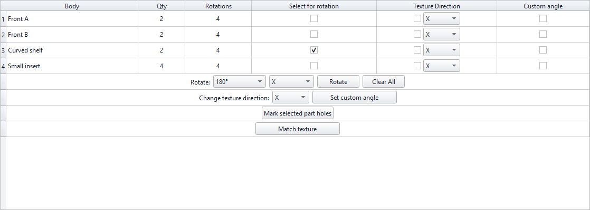

1. Check **Select for rotation** for the parts you want to prepare.
2. Choose **90°** or **180°** in the angle selector below the table.
3. Choose **X** or **Y** as the rotation axis.
4. Click **Rotate** and inspect the preview.

This rotates the working geometry around an X or Y axis. For example, a 180° rotation can bring the opposite face upward. A 90° rotation can change which face forms the nesting footprint, so inspect the result before continuing. Texture group members rotate together.

**Clear All** clears the **Select for rotation** checkboxes. It keeps the parts, quantities, and texture settings.

## 7. Set texture direction and a custom angle

### Texture Direction

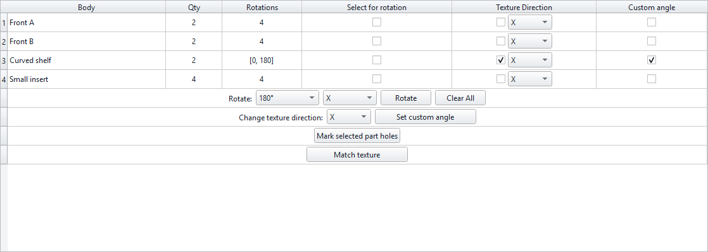

1. Enable **Texture Direction** on the required row.
2. Choose **X** or **Y** according to the part's local texture direction.
3. Inspect the texture arrow and the prepared part.

The part moves into the blue texture preparation area. The geometry and arrow are oriented together so the arrow is horizontal in the top view, including when **Y** is selected. The allowed nesting rotations change to **[0, 180]**.

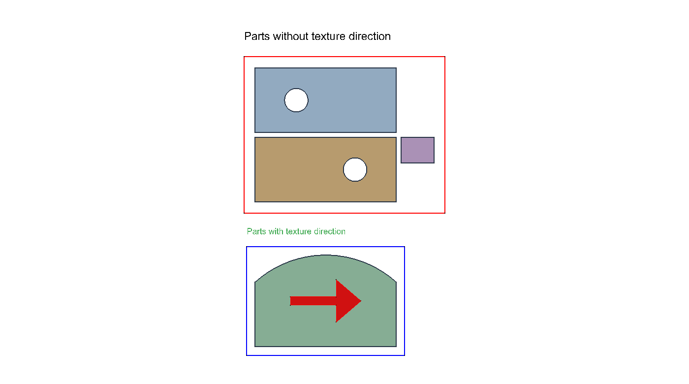

Use **Change texture direction: X / Y** below the table to change the axis for all rows that currently have **Texture Direction** enabled. The change applies immediately. It uses the texture checkboxes, independently of normal row selection and **Select for rotation**.

Also set the material's **Texture direction** through **Edit** when the stock itself has a grain direction that must be respected.

### Set custom angle

1. Enable both **Texture Direction** and **Custom angle** for the parts to adjust.
2. Click **Set custom angle**.
3. Select a part in the dialog's list, then adjust its angle with the dial or numeric field.
4. Watch the live preview. Click **OK** to keep the angles or **Cancel** to restore the previous state.

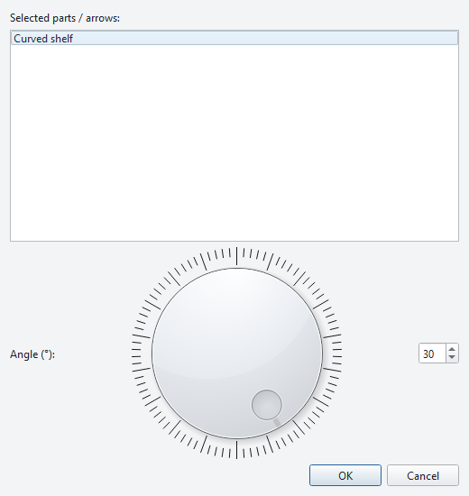

The custom angle changes the prepared relationship between the part and its texture direction. It is separate from the list of rotations the nesting engine may use.

## 8. Mark part holes

Select one part row and click **Mark selected part holes**.

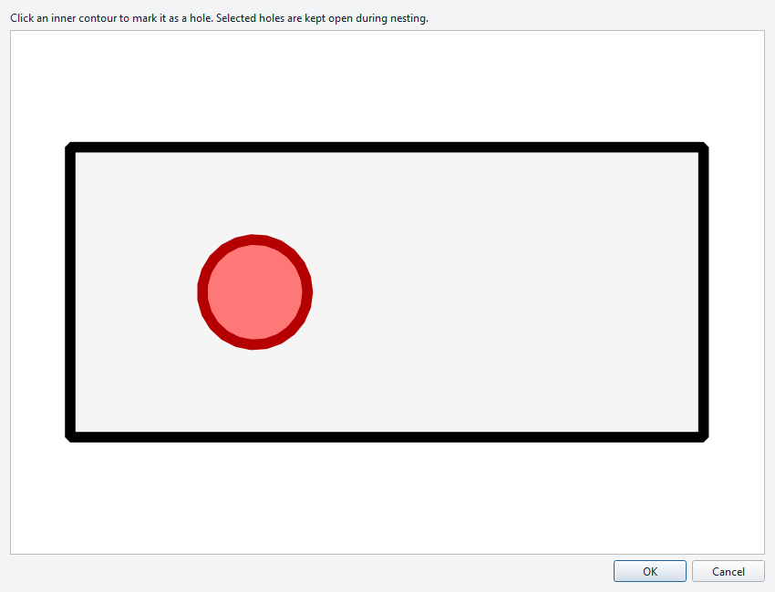

1. Inspect the outer outline and its inner contours.
2. Click an inner contour to mark or unmark it as a hole.
3. Click **OK** to save the selection, or **Cancel** to leave the previous selection unchanged.

Marked holes stay open in the part's nesting profile. This can allow a suitable smaller part to be placed in the open area. Feasibility still depends on its size, spacing, and the nesting search.

Only use physically open holes for this purpose. A blind drilling or groove still contains material beneath it. Hole selection affects the exported nesting profile and net-area calculations; it does not cut or alter the source solid.

## 9. Match texture across several parts

Use **Match texture** when several parts must keep their relative arrangement, such as adjacent cabinet fronts cut from a continuous wood grain pattern.

### Create and arrange a group

1. Give the parts equal **Qty** values. In the example, **Front A** and **Front B** both have a quantity of **2**.
2. Select their rows with **Ctrl** or **Shift**.
3. Click **Match texture**.
4. Drag the outlines into the required arrangement.

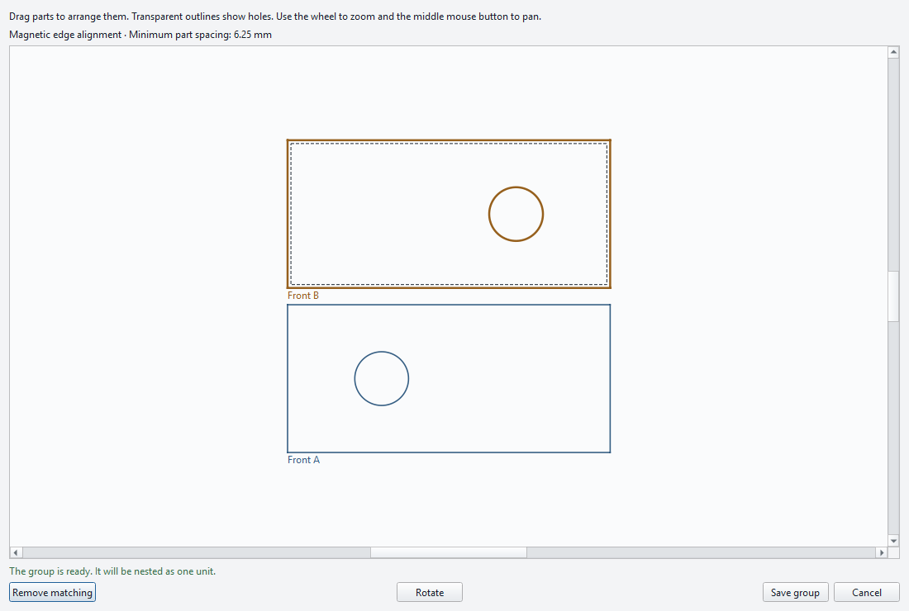

The workspace displays transparent outlines, including internal holes and visible machining edges. It helps you align parts while keeping those features visible.

| Workspace action | How it works |
| --- | --- |
| Move a part | Drag it with the left mouse button. |
| Select a part | Click its outline or material area. |
| Zoom | Turn the mouse wheel. |
| Pan | Drag with the middle mouse button. |
| **Rotate** | Select one part, then rotate it 90° clockwise. |
| **Save group** | Save a valid arrangement and return to the main panel. |
| **Cancel** | Close without saving the edits. |
| **Remove matching** | Undo an existing group and reactivate its individual part rows. For a new unsaved group, abandon the grouping. |

Alignment uses an invisible grid. Its step is one tenth of the shorter bounding-box side of the smallest part, rounded to whole millimetres with a minimum of 1 mm. Parts also snap to useful alignment and spacing positions. Fractional part spacing is preserved: a whole-millimetre grid does not round **6.25 mm** spacing to 6 mm.

Collision detection prevents overlapping parts and enforces **Part Spacing**. If a rotation would produce an invalid arrangement, move the part to make room and try again. **Save group** requires a valid layout.

The workspace **Rotate** command rotates a part in the layout plane. The main-panel **Rotate** command prepares geometry around an X or Y axis, as described in [section 6](#6-prepare-the-visible-face-with-rotate).

### Use, edit, or remove the group

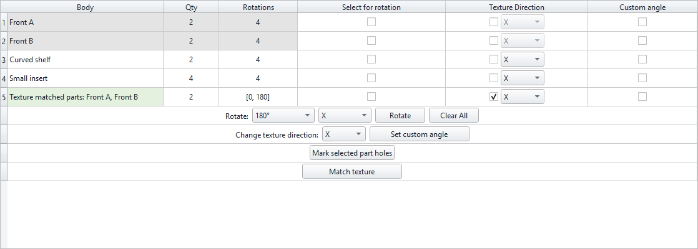

After saving, a numbered **Texture matched parts: …** row appears. Its original member rows become inactive so those parts are not submitted a second time. The group's **Qty** is the number of complete group copies; a quantity of 2 for a two-part group produces two copies of each member.

Use the active group row's quantity, rotation, and texture controls as you would for an ordinary part. Enabling **Texture Direction** prepares the group together and sets **Rotations** to **[0, 180]**.

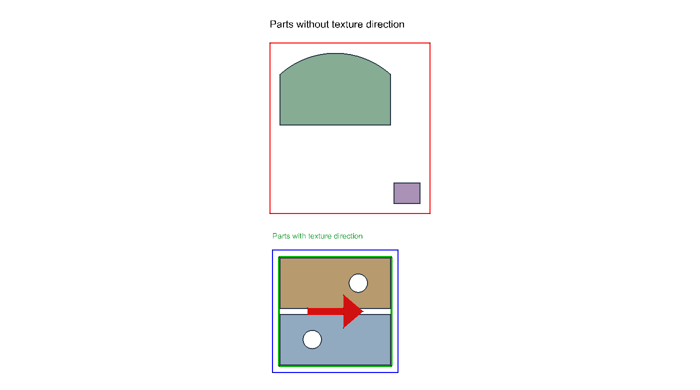

The engine receives the group's contour as one nesting part in the displayed arrangement. Curved edges follow the extracted geometry. The group occupies its reserved footprint; other parts cannot be inserted between its members. The result and SVG report show the individual members again.

To adjust the arrangement, select the group row and click **Match texture** again. To return to independent parts, click **Remove matching** in that dialog. Their original table rows become active again.

## 10. Choose how the nesting search runs

The **Nesting CLI Settings** section is part of the main panel. It controls the current calculation.

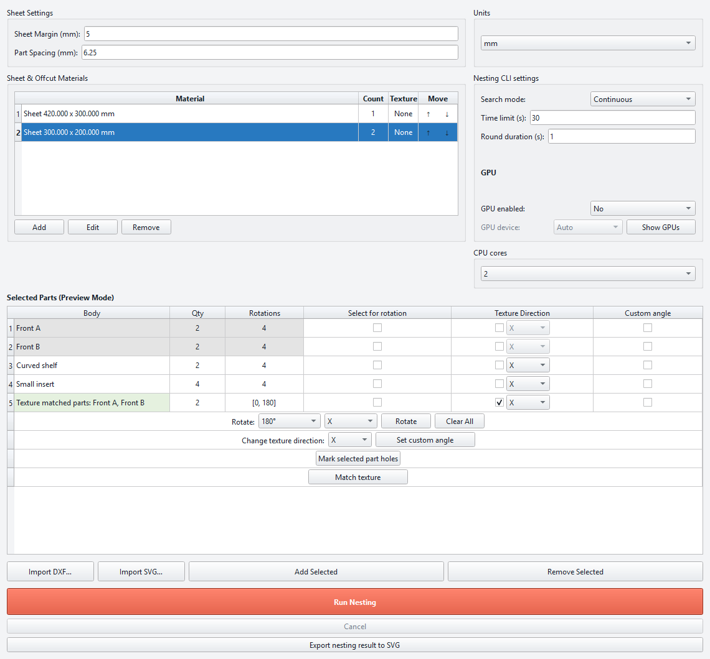

| Control | Meaning |
| --- | --- |
| **Search mode: Fast** | Runs the engine's `first` mode and stops after the initial nesting search. Use it to obtain a first layout quickly. |
| **Search mode: Continuous** | Keeps searching for improvements until the time limit is reached or you cancel. |
| **Time limit (s)** | Total search budget for Continuous mode. Enter `0` to run until cancellation. |
| **Round duration (s)** | Initial layout budget, capped by the remaining total time limit. It is separate from the total job limit. |
| **CPU cores** | Number of CPU workers made available to the calculation. Choose from the available list. |

The time fields are enabled for **Continuous**. For a short trial, choose **Continuous**, a **30-second** time limit, and a **1-second** round duration. Stopping is cooperative, so a calculation already in progress can take a little time to finish.

### GPU controls

- **GPU enabled: No / Yes** controls whether the engine should use GPU processing.
- **GPU device** chooses **Auto** or a detected device. The selector is enabled when GPU processing is enabled.
- **Show GPUs** starts device detection and populates the device list. Its progress dialog can be cancelled.

Available devices depend on the nesting executable and graphics support on the computer. Use **No** for a CPU-only calculation.

## 11. Run Nesting and cancel a search

Before running, check the part quantities, visible faces, material counts, margins, spacing, texture constraints, and rotation rules. There must be at least one part and one sheet or offcut.

Click **Run Nesting**. 1st Nesting captures the prepared job, exports its profiles, and launches the nesting engine. A progress dialog appears while the job is prepared and calculated.

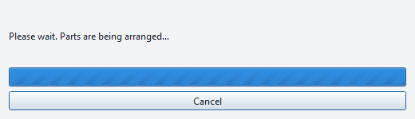

Use **Cancel** in the progress dialog or in the main panel to stop. In Continuous mode, a valid best result already found can be retained. If cancelled before any valid layout is available, there may be no result to import. Wait for cancellation to finish before starting another run.

## 12. Inspect the result

After a successful calculation, FreeCAD activates **Nesting_Result**, switches to the top view, and fits the complete result into the view.

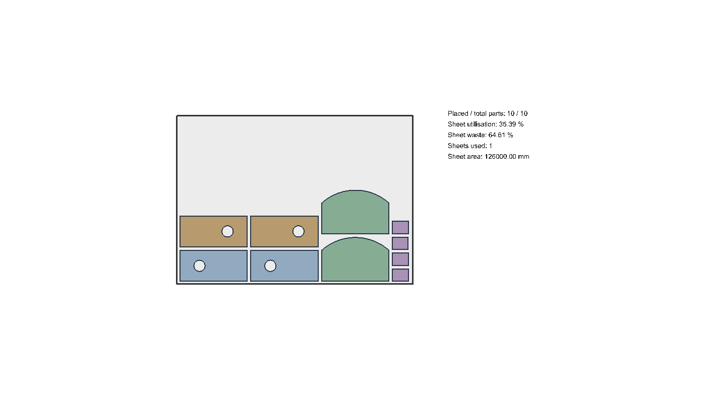

Inspect the following:

- All required copies are placed, and sheet use agrees with the available **Count** values.
- Spacing and sheet margins are appropriate for your process.
- Texture groups retain their internal arrangement and grain alignment.
- Curves, holes, and the prepared face orientations are correct.

The result uses the working part geometry. A matched group expands back into its member parts at their calculated positions. Continuous mode can update the same result document as better layouts arrive.

If parts remain unplaced, inspect the unplaced area and result report. Check stock size and quantity, restrictive rotation rules, texture constraints, and spacing. Adjust the job and run it again. To keep an editable FreeCAD result, save **Nesting_Result** as an **FCStd** document with FreeCAD's normal save command.

## 13. Export the nesting result to SVG

With a successfully imported result available in the current panel, click **Export nesting result to SVG**, choose a destination filename, and save.

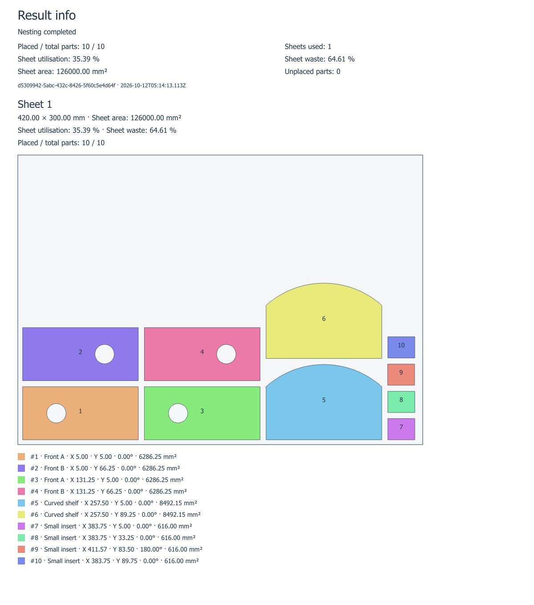

The report includes:

- A separate colour and number for each placed part, including individual texture group members.
- Sheet and offcut outlines, with the selected holes left open.
- Part labels, positions, rotation angles, and areas in the legend.
- Placed and unplaced counts, sheets used, usable sheet area, utilisation, and waste.
- Per-sheet summaries and an overall summary.

Utilisation compares the net placed-part area with the net area of the used stock. Selected holes are subtracted from the relevant areas. The SVG is a visual layout report; prepare toolpaths separately in your CAM workflow.

Open the saved file in an SVG viewer or browser. You can also inspect the [complete SVG report from this example](Example_Nesting_Result.svg). Cancelling the file chooser leaves the result available for a later export.

## Main-window control reference

| Function | Instructions |
| --- | --- |
| **Add Selected**, **Import DXF…**, **Import SVG…** | [Add parts](#1-add-your-parts) |
| **Body**, row selection, row numbers, **Qty**, **Remove Selected** | [Check the part list](#2-check-the-part-list-and-preview) |
| Material **Add**, **Edit**, **Remove**, **Count**, **Texture**, **Move ↑ / ↓** | [Add sheets and offcuts](#3-add-sheets-and-offcuts) |
| **Sheet Margin**, **Part Spacing**, **Units** | [Set distances and units](#4-set-distances-and-display-units) |
| **Rotations** | [Allowed nesting rotations](#5-set-allowed-nesting-rotations) |
| **Select for rotation**, angle, axis, **Rotate**, **Clear All** | [Prepare the visible face](#6-prepare-the-visible-face-with-rotate) |
| **Texture Direction**, row X/Y, **Change texture direction**, **Custom angle**, **Set custom angle** | [Texture direction and custom angle](#7-set-texture-direction-and-a-custom-angle) |
| **Mark selected part holes** | [Mark part holes](#8-mark-part-holes) |
| **Match texture** | [Match texture groups](#9-match-texture-across-several-parts) |
| **Search mode**, **Time limit**, **Round duration**, **CPU cores**, **GPU enabled**, **GPU device**, **Show GPUs** | [Search controls](#10-choose-how-the-nesting-search-runs) |
| **Run Nesting**, **Cancel** | [Run and cancel](#11-run-nesting-and-cancel-a-search) |
| **Export nesting result to SVG** | [Export the SVG report](#13-export-the-nesting-result-to-svg) |

This guide covers the main nesting panel and the dialogs opened from its controls. The separate **Settings** menu is outside its scope.
